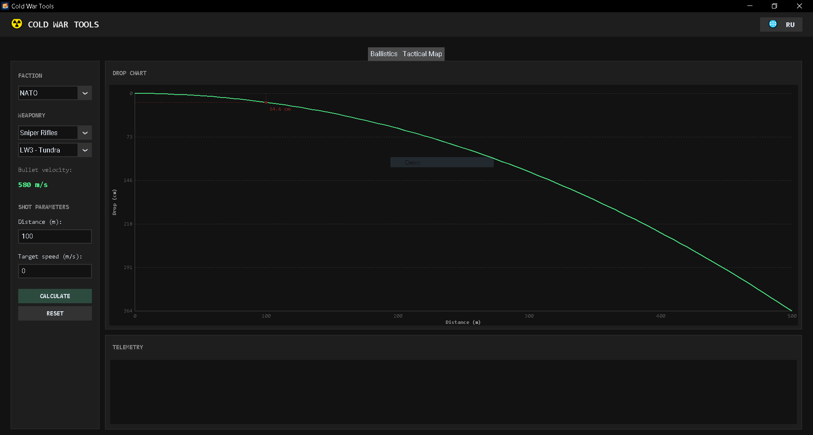
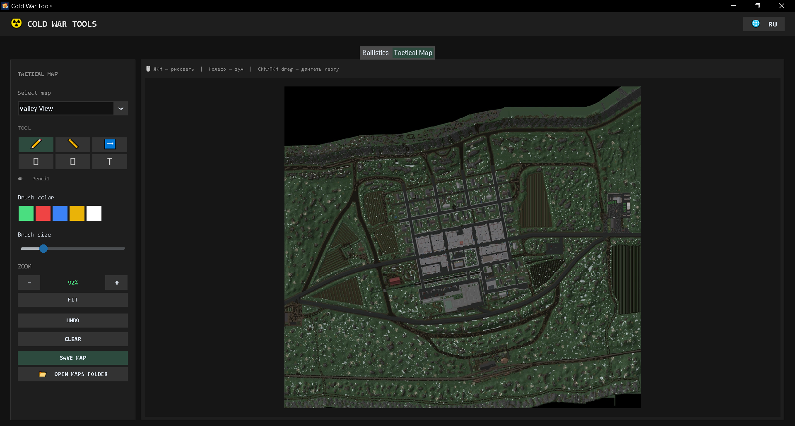

# ☢️ Cold War Tools (Roblox)

[🇷🇺 Русский](README.md) | [🇬🇧 English](README.eng.md)

---


**Cold War Tools** is a desktop utility for players of the Cold War place on the Roblox platform. The application combines an advanced ballistics calculator and an interactive tactical map for action planning and precise shooting.

🌐 **Official Website:** [Cold War Tool](https://coldwartool.netlify.app/) 

---

## ✨ Key Features

*   **📊 Ballistics Calculator:**
    *   Precise calculation of bullet drop and time of flight.
    *   Lead calculation for moving targets.
    *   Real-time interactive trajectory graph visualization.
    *   Weapon database (bullet velocity for various guns).
*   **🗺️ Tactical Map:**
    *   Load custom maps (PNG) from the game.
    *   Annotation tools: pencil, lines, arrows, rectangles, ellipses, and text.
    *   Convenient zoom (mouse wheel) and panning (hold RMB/MMB).
    *   Save the annotated map as PNG.
*   **🌐 Localization:** Full Russian and English support (one-click toggle).
*   **⚡ Standalone:** The app works fully offline, does not require administrator rights, and leaves no system junk behind.

---

## 🖼️ Screenshots

| «Ballistics» Tab | «Tactical Map» Tab |
| :---: | :---: |
|  |  |

---

## 🚀 Installation

A convenient installer is provided for Windows users.

1. Go to the [**Releases**](../../releases/latest) section.
2. Download the latest `ColdWarTools_Setup_v1.0.0.exe` file.
3. Run the installer and follow the instructions (takes less than a minute).

> ⚠️ **Important:** Windows SmartScreen may warn about an "unverified publisher" since the project does not have a paid digital certificate. Click **"More info" → "Run anyway"**.

**Installer SHA-256 hash:**
```text
9198CCC752C1B1F0FED57E4B8C4911F513AED5B3B94421FB60CA7617109781C4
