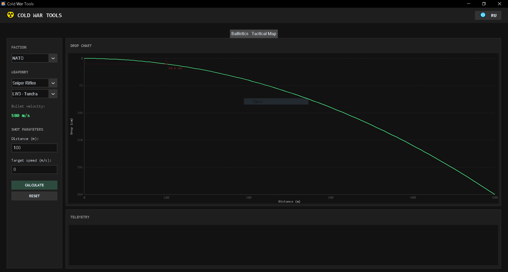
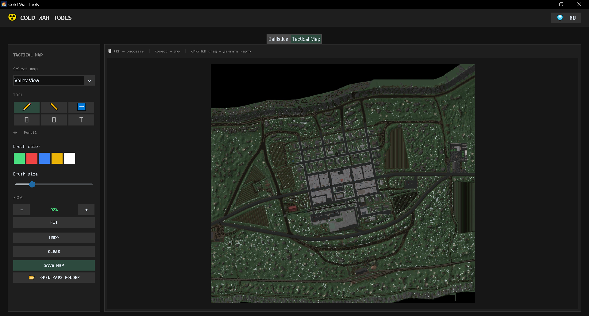

# ☢️ Cold War Tools (Roblox)

[🇷🇺 Русский](README.md) | [🇬🇧 English](README.eng.md)

---

## 🇷🇺 Русский


**Cold War Tools** — это десктопная утилита для игроков в плейс Cold War на платформе Roblox. Приложение объединяет в себе продвинутый баллистический калькулятор и интерактивную тактическую карту для планирования действий и точной стрельбы.

🌐 **Официальный сайт:** [Cold War Tool](https://coldwartool.netlify.app/)

---

### ✨ Основные возможности

*   **📊 Баллистический калькулятор:**
    *   Точный расчёт падения пули (bullet drop) и времени полёта (time of flight).
    *   Расчёт упреждения при стрельбе по движущимся целям.
    *   Визуализация траектории в виде интерактивного графика в реальном времени.
    *   База данных оружия (скорость пули для различных стволов).
*   **🗺️ Тактическая карта:**
    *   Загрузка пользовательских карт (PNG) из игры.
    *   Инструменты разметки: кисть, линии, стрелки, прямоугольники, эллипсы и текст.
    *   Удобный зум (колесом мыши) и панорамирование (зажатой ПКМ/СКМ).
    *   Сохранение размеченной карты в PNG.
*   **🌐 Локализация:** Полная поддержка русского и английского языков (переключение в один клик).
*   **⚡ Автономность:** Приложение работает полностью офлайн, не требует прав администратора и не оставляет мусора в системе.

---

### 🖼️ Скриншоты

| Вкладка «Баллистика» | Вкладка «Тактическая карта» |
| :---: | :---: |
|  |  |

---

### 🚀 Установка

Для пользователей Windows предусмотрен удобный установщик.

1. Перейдите в раздел [**Releases**](../../releases/latest).
2. Скачайте последний файл `ColdWarTools_Setup_v1.0.0.exe`.
3. Запустите установщик и следуйте инструкциям (установка занимает менее минуты).

> ⚠️ **Важно:** Windows SmartScreen может предупредить о «непроверенном издателе», так как проект не имеет платной цифровой подписи. Нажмите **«Подробнее» → «Выполнить в любом случае»**.

**SHA-256 хеш установщика:**
```text
9198CCC752C1B1F0FED57E4B8C4911F513AED5B3B94421FB60CA7617109781C4```
